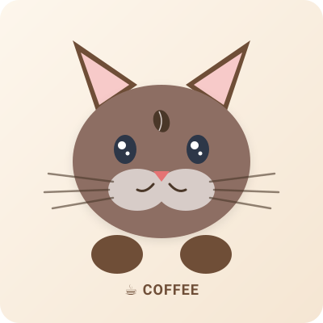

# Karan Thakkar

Husband, cat dad to Coffee, engineer.

  
(cat tax 🐾)

  

I secure cloud infrastructure, developer endpoints, AI agents, and software supply chains at Edwards Lifesciences. I hold an MS in Computer Science from UT Arlington and write about [big ideas – and other problems](https://www.theverge.com/decoder-podcast-with-nilay-patel#:~:text=big%20ideas%20–%20and%20other%20problems) on my [blog](https://blog.karant.dev).

Lived across three continents and love building things. Off the clock, you'll find me tinkering with my [homelab](https://github.com/karant-dev/homelab), hacking ambient tech like my [TRMNL](https://shop.trmnl.com/products/trmnl-x), Pebble [Index 01](https://repebble.com/index) and some Alexa Echoes, or improving my personal Telegram agent. Next on my list is learning woodworking.
